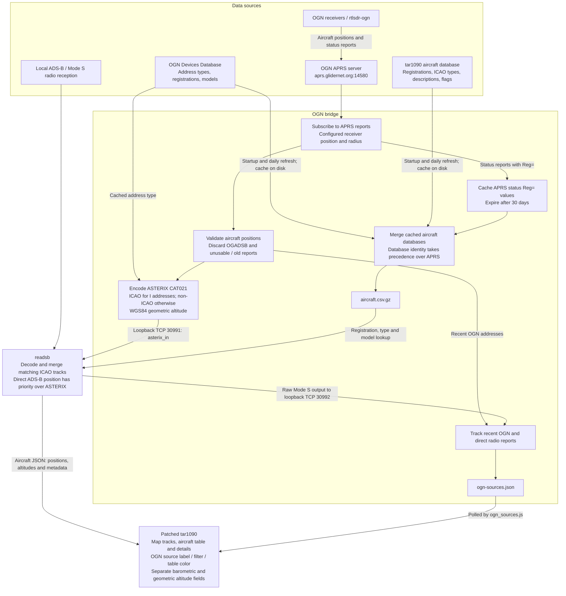

# OGN APRS to readsb ASTERIX bridge

This bridge subscribes to `aprs.glidernet.org:14580` near the configured
OGN receiver station. It converts OGN aircraft position reports to ASTERIX CAT021 and
serves the stream on loopback TCP port 30991. The installed `readsb` connects
to that port, so tar1090 displays the aircraft through its normal readsb feed.

## Data flow



The raw Mode S path supplies source-label evidence only. For a shared ICAO
address, readsb can combine OGN position and geometric altitude with directly
received Mode S barometric altitude and squawk. Non-ICAO OGN targets stay
separate, with a `~` address prefix. Tar1090 uses recent reception history to
label shared ICAO tracks; its map markers retain the normal altitude colors.

## Prerequisites
- running **rtlsdr-ogn** instance (e.g. based on https://github.com/VirusPilot/ogn-pi34)
- running **readsb** instance (e.g. based on: https://github.com/wiedehopf/readsb)

## Installation

Run on the receiver host:

```sh
sh /home/pi/ogn-asterix-bridge/install.sh
```

The installer renders [ogn-asterix-bridge.service](./ogn-asterix-bridge.service)
as a template. It reads APRS `Call` from the active OGN decoder configuration
referenced by `/etc/rtlsdr-ogn.conf`. If no decoder entry is found, it tries
`/home/pi/rtlsdr-ogn/Template.conf`. If OGN has no `Call`, it accepts readsb's
`CALLSIGN` or `RECEIVER_CALLSIGN` setting.

It reads latitude and longitude from readsb's `DECODER_OPTIONS` when both are
set. Otherwise, it uses the OGN `Position` section. Installation stops if it
cannot find a receiver callsign or a complete position. Rerun the installer after
changing these settings. The service template's `--radius-km 50` requests
OGN APRS reports within 50 km of that position.

Check the bridge with:

```sh
sudo journalctl -u ogn-asterix-bridge -f
```

At startup, the log shows the cached database counts, the merged database
rebuild, and the result of each online database check, including unchanged
downloads. The same checks run daily.

The bridge requires Python 3 and no third-party Python packages.
The installer also connects readsb's raw Mode S output to loopback port 30992.
The bridge uses those messages to identify aircraft received directly by
readsb; raw messages are not injected back into readsb.

## Forwarded traffic

The bridge discards position reports with the `OGADSB` APRS tocall. It forwards
valid aircraft positions from the other [OGN APRS tocalls], including positions
whose source callsign begins `ICA`. It does not compare them with readsb's
directly received ADS-B traffic. Receiver status and weather messages without
an aircraft position and device ID cannot be encoded as CAT021 aircraft tracks.
The readsb connector reconnects automatically after either service restarts.

## Altitude display

OGN `/A=` is WGS84 geometric altitude. The bridge sends it only as ASTERIX
I021/140, and readsb publishes it as `alt_geom`. The installer patches
tar1090's two barometric altitude detail fields to read `alt_baro` instead of
its generic altitude fallback. This shows `n/a` for OGN aircraft without
pressure altitude and retains WGS84 altitude in the geometric field.

Rerun the patch if a tar1090 update replaces its JavaScript file:

```sh
sudo python3 /home/pi/ogn-asterix-bridge/patch_tar1090.py
```

## Source label and color

The bridge uses the [OGN Devices Database] to determine whether a six-digit
OGN device ID is a valid ICAO address. An `I` address is sent unchanged, so
readsb can combine its OGN report with directly received Mode S or ADS-B from
the same aircraft. `F` (FLARM), `O` (OGN), and unlisted addresses are sent as
non-ICAO addresses, which readsb shows with a `~` prefix. This prevents an
unrelated ICAO aircraft with the same six-digit code from being merged with
the OGN target. Tar1090 determines the displayed source label separately.

The tar1090 patch labels `~`-prefixed ASTERIX targets as `OGN`. For an `I`
address, the bridge tracks recent OGN reports and readsb's directly received
Mode S messages separately. Tar1090 labels that address `OGN` when it has a
recent OGN report and no recent direct radio message. Directly received
aircraft retain their normal source label. This provenance is served through
`ogn-sources.json` in tar1090; if the raw output or status file is unavailable,
ICAO targets retain tar1090's normal source label.

When an `I` address is also received directly over ADS-B, readsb merges both
inputs under the same hex code. It assigns injected ASTERIX data lower priority
than direct ADS-B, so a recent ADS-B position normally wins even if an OGN
report arrives later. OGN can still supply a field that direct reception has
not supplied, such as geometric altitude. The direct source label on the merged
tar1090 track does not mean that the OGN report was discarded.

This also applies to a Mode S-only transponder with the same valid ICAO hex
address. Readsb can combine its directly received barometric altitude and
squawk with OGN GPS position and WGS84 geometric altitude. If the OGN position
passes readsb's validity and range checks, tar1090 can plot the combined
track even though Mode S itself supplies no position. The OGN report must have
a tocall other than `OGADSB`, and the OGN database must mark its address `I`
so the bridge sends it without `~`.

While direct Mode S messages are recent, tar1090 labels this merged track
`ADS-B` even if OGN supplies its position. Readsb reports the combined track
as `adsb_icao`, and the source-label logic treats recent Mode S reception as
direct traffic. If direct reception ages out while OGN reports continue, the
label can change to `OGN`.

Selecting `OGN` in the source filter shows both non-ICAO OGN tracks and
ICAO OGN tracks without recent direct radio reception, whether or not the
optional AIS source is available. Those tracks use the former AIS
source color in the aircraft table, source legend, and source filter, including
the selected-row shade. Map marker colors still follow tar1090's altitude
colors.

## Registration

The bridge reads `Reg=` only from status reports delivered by the subscribed
OGN APRS feed. Its range filter may omit status reports; when that happens,
registrations come from the aircraft databases instead.

APRS registrations are saved in
`/var/lib/ogn-asterix-bridge/registrations.json`. The bridge merges the
[tar1090 aircraft database] with the [OGN Devices Database] into
`/var/lib/ogn-asterix-bridge/aircraft.csv.gz`, which the installer sets as
readsb's aircraft database. This retains the tar1090 registrations, ICAO types,
flags, and other fields. Public OGN device records add registrations and models
where the tar1090 record has no value. Readsb checks for database updates about
every 30 seconds, so a change can take that long to appear in tar1090.

Saved APRS registrations expire after 30 days without another status report.

For each six-digit OGN device ID, a database registration takes precedence:
the tar1090 record for an ICAO (`I`) address, then the public OGN device
registration or its `CN` callsign. APRS `Reg=` is used only if neither database
identifies the device. FLARM (`F`), OGN (`O`), and unknown addresses remain in
readsb's non-ICAO address space so an unrelated ICAO record cannot supply their
registration. Both source databases are downloaded at startup and daily
thereafter; cached copies (`tar1090.csv.gz` and `ddb.csv`) are used during
network outages.

## Aircraft type

For publicly identified devices, the bridge uses OGN `AIRCRAFT_MODEL` as
readsb's long aircraft description (`desc`) when the tar1090 record has no
description. The installer enables
`--db-file-lt` so readsb includes it in aircraft JSON. Tar1090 shows the model
in the Type column and in the selected aircraft's type details. The database
model is free text, so it is not written to readsb's four-character ICAO type
code field (`t`).

[OGN APRS tocalls]: https://github.com/glidernet/ogn-aprs-protocol/blob/master/tocalls.txt
[OGN Devices Database]: https://ddb.glidernet.org/download/
[tar1090 aircraft database]: https://github.com/wiedehopf/tar1090-db/raw/csv/aircraft.csv.gz
